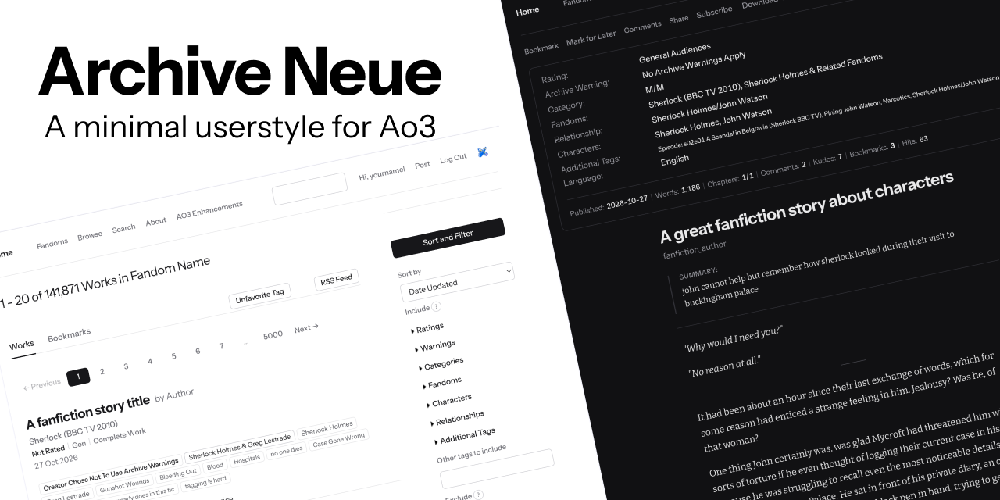
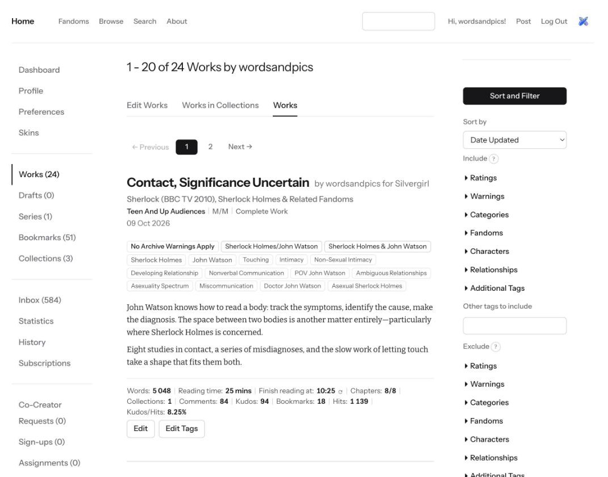
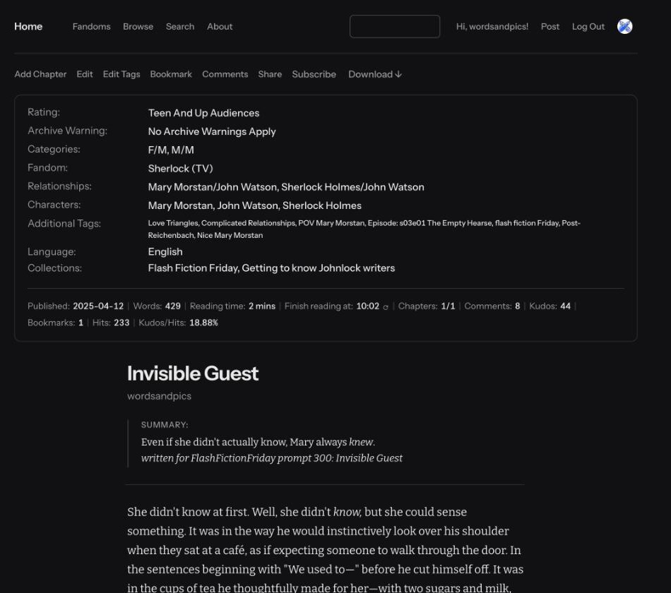
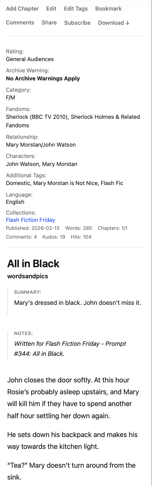
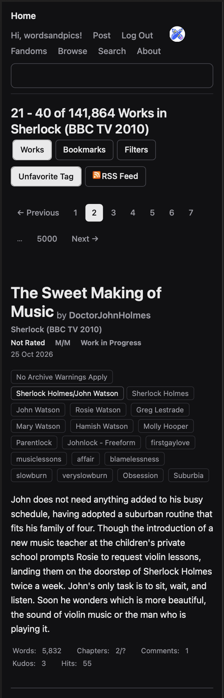

A quiet, minimal look for [Archive of Our Own](https://archiveofourown.org) (AO3).

- **Desktop style.** Installs with the free [Stylus](https://add0n.com/stylus.html) browser extension.
- **Phone skin.** A simpler version you paste into AO3's own skin settings. No extension needed.
- **Customisable.** Light, dark or follow your system. Fonts, text size, line spacing, text width and accent colour. (The phone skin is light or dark only.)

Works on `archiveofourown.org`, `archiveofourown.gay` and `archive.transformativeworks.org`.

## Install the desktop style

1. Install [Stylus](https://chromewebstore.google.com/detail/stylus/clngdbkpkpeebahjckkjfobafhncgmne) (for Chrome, Brave, Edge and Firefox)
2. [Open this link](https://raw.githubusercontent.com/wordsandpics/archive-neue-ao3/main/archive-neue.user.css). Stylus offers to install the style.
3. Click **Install**, then reload AO3.

The style is also listed on [userstyles.world](https://userstyles.world/style/31084/archive-neue-for-ao3).

Stylus checks for new versions on its own. Other style extensions are untested and may not read the file or its settings.

**Settings:** click the Stylus icon, then the gear next to Archive Neue. You can change the colour theme (follow system, always light, always dark), reading font, interface font, reading size, line height, text column width and accent colour.

**Fonts:** the style loads Bitter (reading) and Instrument Sans (interface) from Google Fonts, so your browser contacts Google when an AO3 page loads. Both fonts are open-licensed. To use other fonts, change the font names in the settings (and the `@import` line at the top of the file if the font comes from Google Fonts).

**Other extensions:** a clearly labelled block at the end of the file styles the "AO3 Enhancements" extension. Comment it out if you don't use it.

 

## Install the phone skin

Pick **one** file: `skin/archive-neue-skin-light.css` (light) or `skin/archive-neue-skin-dark.css` (dark).

1. Log in to AO3, open your name, then **Preferences**, then **Skins & Archive Interface**, then **Create Site Skin**.
2. Give it a title and paste the whole file into the CSS box. AO3 does not allow the word "Archive" in a skin title, so use something like "Neue Light" or "Neue Dark".
3. Open **Advanced**, then **Media**. Tick only `only screen and (max-width: 42em)`. Leave the role on "add on to archive skin". Submit.
4. Back in Preferences, press **Use** next to your new skin.

Notes:
- The skin only applies on narrow screens, so desktop looks the same with or without it.
- It only uses fonts already on your device.
- It does not follow the phone's light/dark setting. To switch, create the other skin the same way and press **Use** on it.
- It does not update itself. When there is a new version, paste it over the old one.
- AO3 does not read `@media` rules written inside a skin. The Media setting above is how the narrow-screen condition works.

 

## Known gaps

This is a work in progress. Not every page and element is styled yet.

- Tested in Chrome, Brave and Firefox (with Stylus). Edge is untested.
- In Firefox the web fonts (Bitter and Instrument Sans) don't load, so your system's fonts are used instead. Everything else works.
- The phone skin has been checked on a limited set of pages.

Found something that looks wrong? Open an [issue](https://github.com/wordsandpics/archive-neue-ao3/issues) with a screenshot and the page address.

## Unofficial

Archive Neue is a fan-made style. It is not made, endorsed or supported by AO3 or the Organization for Transformative Works (OTW).

## Licence

[MIT](LICENSE). Copyright (c) 2026 wordsandpics.
