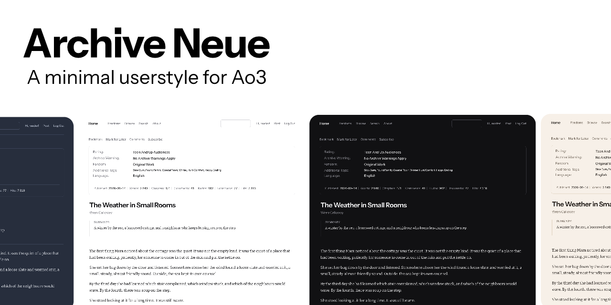
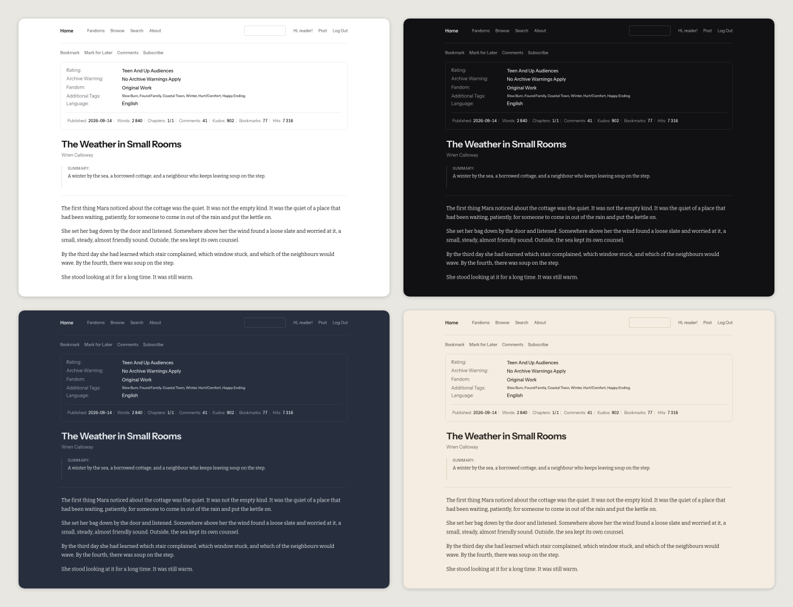
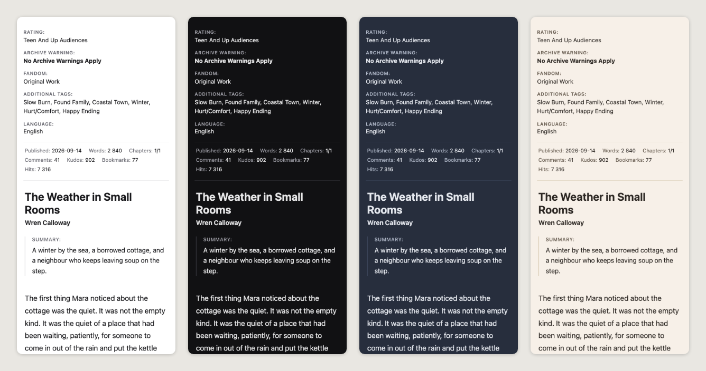

A minimal, typography-first reading theme for [Archive of Our Own](https://archiveofourown.org) (AO3). Airy and discreet. Light, dark, slate or paper, or follows your system.

- **Desktop style.** Installs with the free [Stylus](https://add0n.com/stylus.html) browser extension.
- **Skin.** A simpler version you paste into AO3's own skin settings. No extension needed. Use it as a phone-only companion to the desktop style, or on its own as a simpler version for every screen.
- **Customisable.** Light, dark, slate (blue-grey), paper (warm beige) or follow your system. Fonts, text size, line spacing, text width and accent colour. (Each skin file is one theme.)

Works on `archiveofourown.org`, `ao3.org`, `archiveofourown.gay` and `archive.transformativeworks.org`.

## Install the desktop style

1. Install [Stylus](https://chromewebstore.google.com/detail/stylus/clngdbkpkpeebahjckkjfobafhncgmne) (for Chrome, Brave, Edge and Firefox)
2. [Open this link](https://raw.githubusercontent.com/wordsandpics/archive-neue-ao3/main/archive-neue.user.css). Stylus offers to install the style.
3. Click **Install**, then reload AO3.

The style is also listed on [userstyles.world](https://userstyles.world/style/31084/archive-neue-for-ao3).

Stylus checks for new versions on its own. Other style extensions are untested and may not read the file or its settings.

**Settings:** click the Stylus icon, then the gear next to Archive Neue. You can change the colour theme (follow system, light, dark, slate or paper), reading font, interface font, reading size, line height, text column width and accent colour. There is also a "Collapse long tag lists (work page)" option, off by default.

**Fonts:** the style loads Bitter (reading) and Instrument Sans (interface) from Google Fonts, so your browser contacts Google when an AO3 page loads. Both fonts are open-licensed. To use other fonts, change the font names in the settings (and the `@import` line at the top of the file if the font comes from Google Fonts).

**Other extensions:** a clearly labelled block at the end of the file styles the "AO3 Enhancements" extension. Comment it out if you don't use it.

## Install the skin

Pick **one** file: `skin/archive-neue-skin-light.css` (light), `skin/archive-neue-skin-dark.css` (dark), `skin/archive-neue-skin-slate.css` (blue-grey), `skin/archive-neue-skin-paper.css` (warm beige) or `skin/archive-neue-skin-contrast.css` (light with black text and darker lines, good for e-ink readers or if you prefer stronger contrast).

1. Log in to AO3, open your name, then **Preferences**, then **Skins & Archive Interface**, then **Create Site Skin**.
2. Give it a title and paste the whole file into the CSS box. AO3 does not allow the word "Archive" in a skin title, so use something like "Neue Light" or "Neue Dark".
3. Open **Advanced**, then **Media**. For a phone-only skin, tick `only screen and (max-width: 42em)`, which covers most phones, or `only screen and (max-width: 62em)` if you also want it on a tablet or e-reader. To use it on every screen, leave the Media boxes unticked. Leave the role on "add on to archive skin". Submit.
4. Back in Preferences, press **Use** next to your new skin.

Notes:
- With a Media box ticked it only applies on narrow screens, so a desktop looks the same with or without it. Without one it applies everywhere.
- It only uses fonts already on your device.
- It does not follow the phone's light/dark setting. To switch, create the other skin the same way and press **Use** on it.
- It does not update itself. When there is a new version, paste it over the old one.
- AO3 does not read `@media` rules written inside a skin. The Media setting above is how the narrow-screen condition works.

## Known gaps

This is a work in progress. Not every page and element is styled yet.

- Tested in Chrome, Brave and Firefox (with Stylus). Edge is untested.
- In Firefox the web fonts (Bitter and Instrument Sans) don't load, so your system's fonts are used instead. Everything else works.
- It should work on most pages. If something looks wrong, please report it.

Found something that looks wrong? Open an [issue](https://github.com/wordsandpics/archive-neue-ao3/issues) with a screenshot and the page address.

## Unofficial

Archive Neue is a fan-made style. It is not made, endorsed or supported by AO3 or the Organization for Transformative Works (OTW).

## Licence

[MIT](LICENSE). Copyright (c) 2026 wordsandpics.
